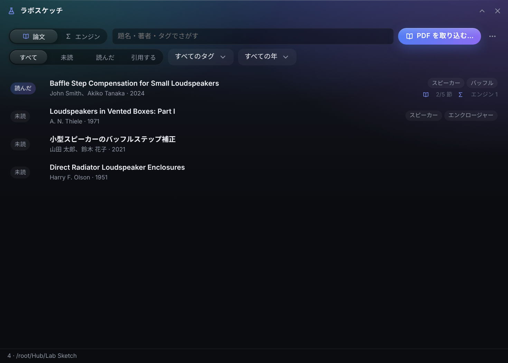
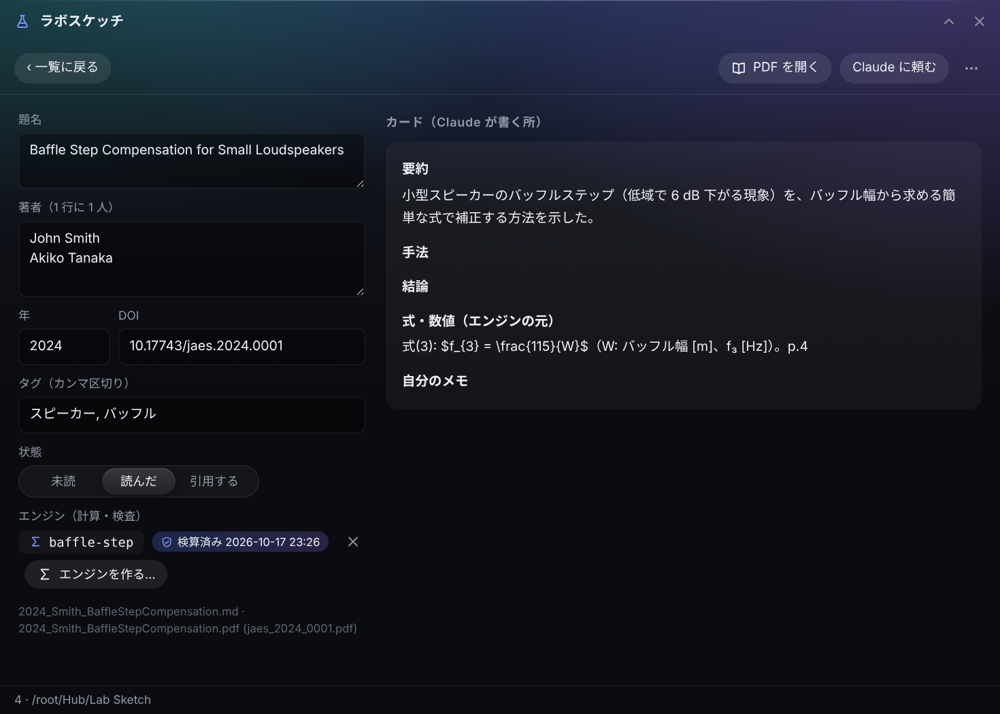
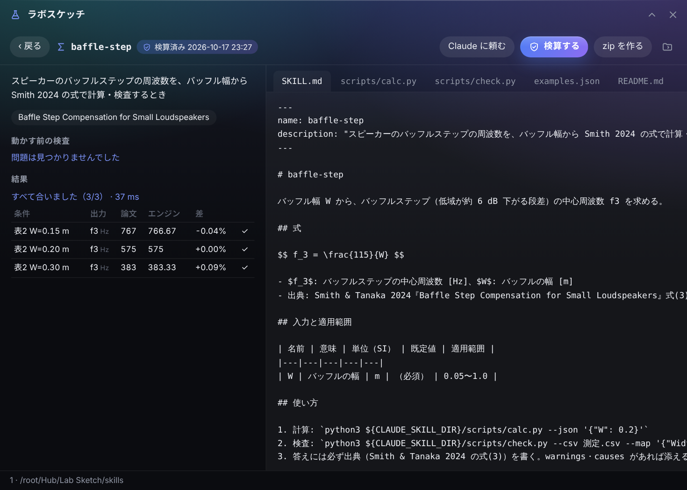

# ラボスケッチ（Lab Sketch）

<p align="center"><a href="README.md">English</a> · <b>日本語</b></p>

Windows のデスクトップの端に置く作業台 **[Hub](https://github.com/satosugarforwork44x-lang/desktop-hub)** の拡張です。
**論文 1 本 = md のカード 1 枚。** PDF を落とすと、題名・著者・年・DOI を PC の中だけで推定してカードを作ります。要約は Claude がカードに書きます。
さらに論文の**式を「計算エンジン」と「検査エンジン」**にして **Claude の skill** にまとめます。論文の表の値で PC で検算し、zip にして登録すれば、どのチャットからでも使えます（「Smith の式で、幅 20 cm のバッフルステップは？」「この実測は論文と合ってる？」）。



> ライセンス: [PolyForm Noncommercial 1.0.0](LICENSE)（個人・非商用は無料）

## 作った理由

論文は読んで終わりではなく、**式を使う**ところまでが仕事です。そして、まちがいが入るのはそこです。

- **式を手で打ち直す。** 表計算や使い捨てのスクリプトに写すうちに、単位や 2 倍の取り違えが気づかれずに入る
- **AI はそれらしく暗算する。** 「Smith の式だといくつ？」と聞くと、論文を見ずに、出典も書かずに、自信を持って答えることがある
- **文献管理ソフトは書誌で止まる。** PDF と BibTeX は残るが、方法は残らない

そこで、論文は Claude が読み書きできるただのカードにし、式は**論文自身の数値を再現できたときだけ使える小さなプログラム**にしました。

## UX で決めたこと

- **ただのファイル、データベースなし。** カードは front matter 付きの md。Claude は Hub に元からある MCP の道具で読み書きする。Hub に道具を足さずに済んだ
- **わざとオフライン。** Crossref・arXiv には問い合わせない（論文を PC の外に出さない）。推定は、書き込む**前**に小窓で見せて直せる。あとでカードの上でも直せる
- **危ないところは自動にしない。** エンジンは Claude が書くが、Lab Sketch は勝手に動かさない。中身を読んで「検算する」を押し、最初に一度確かめる
- **ごまかせない検算。** `examples.json` は論文の表・図の値から取る決まり。検算が通るとファイルのハッシュを残し、1 行でも変えると、もう一度検算するまで zip は作れない
- **エンジンは論文ごとでなくテーマごと。** Claude は description で skill を選ぶので、似た skill が並ぶと迷う。1 つのエンジンに複数の論文を出典として持てる
- **合わない理由を出す。** 値が合わないとき、ずれ方から原因の候補を出す（どれも 1000 倍 → 単位、2π 倍 → ω と f、2 倍 → 半径と直径、同じ向き → 条件か係数）



## できること

| | |
|---|---|
| **取り込み** | PDF を落とす（Hub のフォルダ窓「Lab Sketch」に入れてもよい）。題名は 1 ページ目のいちばん大きい字、著者はその下の行、年は ©・Published の近く、DOI は形から。足りなければ PDF の埋め込み情報。ファイル名は `年_第一著者_短い題名` を提案（日本語でよい）。コピーか移動。同じ PDF は知らせる |
| **一覧** | 題名・著者・タグ・DOI でさがす。状態（未読・読んだ・引用する）・タグ・年で絞り込み |
| **カード** | 書誌・タグ・状態を直す（本文は Claude の場所）。PDF を Hub のビューアで開く。カードと PDF の名前を一緒に変える。Claude に頼む文をコピー |
| **エンジン** | 「エンジンを作る…」でひな形 `skills/<名前>/`。画面で全部のファイルを読める。動かす前の検査、検算、zip |
| **引用** | 一覧に出ている論文を BibTeX か参考文献の一覧（md）に（先に「引用する」で絞る） |



## はじめかた

1. このフォルダを `Hub\modules\lab`（または `%LOCALAPPDATA%\Hub\modules\lab`）に置き、Hub を再起動。バーにフラスコが出る
2. PDF から題名・著者を読むには PyMuPDF（AGPL-3.0。同梱しない）を入れる:
   `py -3.14 -m pip install --user pymupdf`
   無くても、カードはファイル名で作れる
3. Hub の設定 → Claude との連携で、フォルダ窓「Lab Sketch」を「読み書き」で見せる

## Claude と使う

1. PDF を落とす → 推定を直す → 「取り込む」
2. カードの「Claude に頼む」で頼む文がコピーされる。Claude Desktop に貼ると、Claude が PDF を読んで「要約・手法・結論・式・数値」を書く（「自分のメモ」は書かない）。2 秒以内に画面が読み直す
3. 「エンジンを作る…」→ 名前（`baffle-step`）→ また頼む文がコピーされる。Claude は `LAB_FORMAT.md` に従って `SKILL.md`・`scripts/calc.py`・`examples.json` を書く
4. ファイルを読む →「検算する」→ 全部合ったら「zip を作る」
5. `export/<名前>.zip` を claude.ai かデスクトップアプリの **Customize > Skills** でアップロードして、オンにする

Claude が従う決まりは [`LAB_FORMAT.md`](LAB_FORMAT.md)（Lab Sketch がフォルダに置く）。

## ファイルの形

```
Lab Sketch/
  LAB_FORMAT.md                 Claude 向けの決まり（Lab Sketch が置く）
  papers/<名前>.pdf
  papers/<名前>.md              カード
  skills/<エンジン>/            SKILL.md, scripts/calc.py, scripts/check.py, examples.json, README.md
  export/                       <エンジン>.zip, references.bib, references.md
```

front matter は YAML の小さな部分（`key: 値`、`[a, b]` の一覧）だけを使い、標準ライブラリで読みます。知らないキーは消さずに残します。

## 検算の動かし方

AI が書いたコードを PC で動かすので、慎重に、ただし限界は正直に:

1. **動かす前に調べる**（Python の `ast`）: import は許可の一覧の物だけ（math・statistics・json・csv など、任意で numpy）。ネット・外部コマンド・ファイルの書き込みや削除・`eval`/`exec` があれば止める
2. **別のプロセスで動かす**: Hub と同じ Python（`-E -B`）、skill のフォルダの中、最大 **10 秒**
3. **印を残す**: 結果とファイルのハッシュ。zip の中は Claude が求める `<名前>/SKILL.md …` の形

これは「うっかり」を防ぐ物で、**完全な隔離ではありません**。だから画面は「中身を読んでから」動かすようにしています。

## 開発

```bat
py -3.14 -m unittest discover -s tests -v
```

テスト 21 本: front matter の往復、作った PDF（英語・日本語）からの書誌の推定、日本語のファイル名、取り込み・名前の変更・二重取り込み、エンジンのひな形から zip まで、止めるコード、時間切れ、検算の印、BibTeX。

## 依存とライセンス

| | ライセンス | |
|---|---|---|
| Python 標準ライブラリ | PSF | PDF を読む以外のすべて |
| [PyMuPDF](https://pymupdf.readthedocs.io/) | AGPL-3.0 | 任意。**同梱しない**（Hub と同じく利用者が入れる） |

ラボスケッチ自体は **[PolyForm Noncommercial 1.0.0](LICENSE)** です。個人・学習・研究などの非商用なら無料で使え、読め、直せ、配れます。商用で使いたい場合は作者に連絡してください。
`docs/` の画面に出ている論文・数値・エンジンは**架空の見本**で、実在の論文ではありません。
