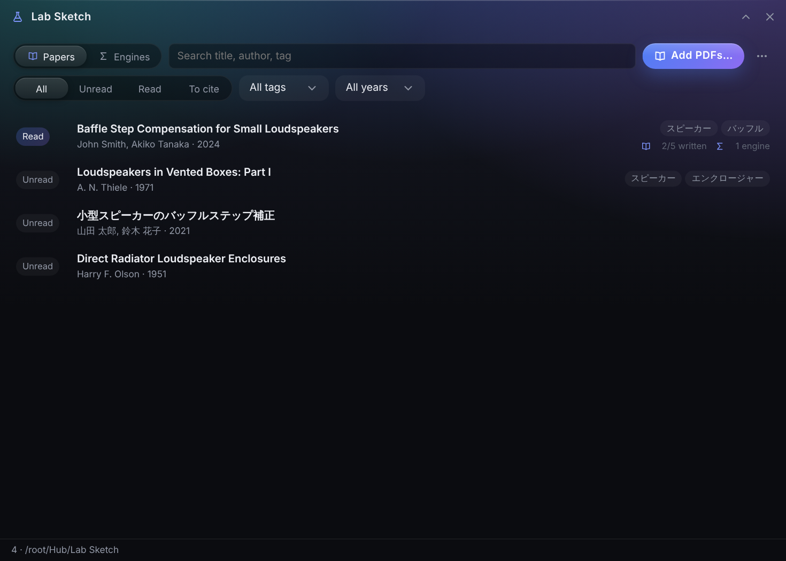
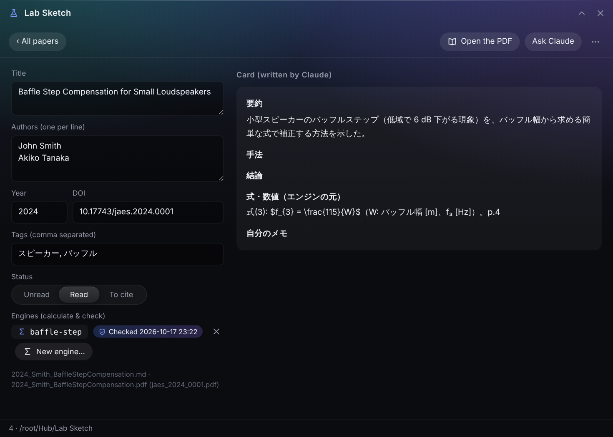
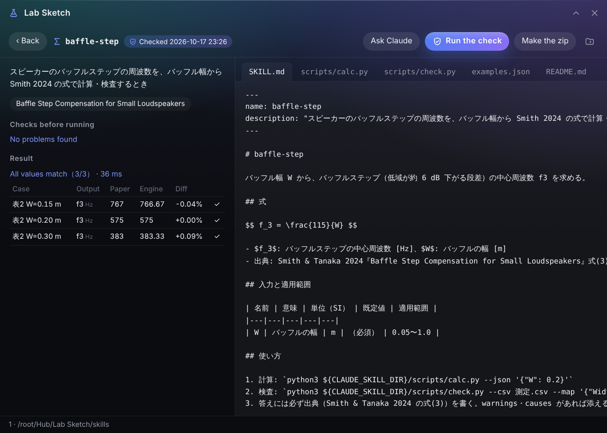

# Lab Sketch

<p align="center"><b>English</b> · <a href="README.ja.md">日本語</a></p>

An extension for **[Hub](https://github.com/satosugarforwork44x-lang/desktop-hub)**, a workbench that sits at the edge of the Windows desktop.
**One paper, one Markdown card.** Drop a PDF and Lab Sketch guesses its title, authors, year and DOI — offline — and makes a card. Claude writes the summary into the card.
Then the paper's **equations become a calculation engine and a check engine**, packaged as a **Claude skill**: checked against the paper's own tables on your PC, zipped, and usable from any Claude chat ("What's the baffle step for a 20 cm baffle, by Smith's equation?", "Does this measurement agree with the paper?").



> License: [PolyForm Noncommercial 1.0.0](LICENSE) (free for personal and non-commercial use)

## Why

Reading a paper is only half the job. The other half is **using its equations** — and that is where things go wrong.

- **Equations get retyped by hand,** into spreadsheets or one-off scripts, and a unit or a factor of 2 slips in without anyone noticing
- **AI is happy to compute from memory.** Asked "what does Smith's equation give for this?", a chat model may answer confidently, without the paper and without a source
- **Reference managers stop at the bibliography.** They keep the PDF and the BibTeX, not the method

So Lab Sketch keeps papers as plain cards that Claude can read and write, and turns equations into small programs that **must reproduce the paper's own numbers before they can be used**.

## UX decisions

- **Plain files, no database.** A card is a Markdown file with a small front matter; Claude reads and writes it through Hub's existing MCP tools. No new MCP tools were needed
- **Offline on purpose.** No Crossref or arXiv lookups — papers stay on the PC. The guess is shown in a dialog *before* anything is written, and every field can be fixed later on the card
- **Ask, don't automate the risky part.** Claude writes the engine; Lab Sketch never runs it by itself. You read the code, press *Run the check*, and confirm once
- **A check that can't be faked.** `examples.json` must come from the paper's tables or figures. A passing check stores a hash of the files; change one line and the zip button goes grey until you check again
- **One engine per topic, not per paper.** Claude chooses skills by their description, so a pile of near-identical skills would confuse it. An engine can cite several papers
- **Explain mismatches.** When values don't match, the check engine suggests causes from the pattern — all off by ×1000 (units), ×2π (ω vs f), ×2 (radius vs diameter), all in one direction (conditions or a coefficient)



## Features

| | |
|---|---|
| **Import** | Drop PDFs (or put them into the *Lab Sketch* folder in Hub). Title from the largest text on page 1, authors from the line below, year near ©/Published, DOI by pattern; PDF metadata as a fallback. Suggested file name `year_FirstAuthor_ShortTitle` (Japanese names are fine). Copy or move. Duplicate PDFs are detected |
| **List** | Search title, authors, tags, DOI. Filter by status (unread / read / to cite), tag and year |
| **Card** | Edit bibliography, tags and status; the body stays Claude's. Open the PDF in Hub's viewer. Rename the card and PDF together. Copy a ready-made request for Claude |
| **Engines** | *New engine…* creates `skills/<name>/` from a template. Read every file in the app, see the pre-run checks, run the check, make the zip |
| **Cite** | Export the papers shown in the list as BibTeX or a Markdown reference list (filter *To cite* first) |



## Getting started

1. Put this folder at `Hub\modules\lab` (or `%LOCALAPPDATA%\Hub\modules\lab`) and restart Hub. A flask appears on the bar
2. To read titles and authors from PDFs, install PyMuPDF (AGPL-3.0, not bundled):
   `py -3.14 -m pip install --user pymupdf`
   Without it, cards are still made from the file name
3. In Hub's settings → *Claude*, share the **Lab Sketch** folder with Claude as *read & write*

## Using it with Claude

1. Drop a PDF → fix the guess → *Add*
2. On the card, *Ask Claude* copies a request. Paste it into Claude Desktop — Claude reads the PDF and fills *Summary / Method / Conclusions / Equations & values* (never *My notes*). The card updates within 2 seconds
3. *New engine…* → name it (`baffle-step`) → a request is copied again. Claude writes `SKILL.md`, `scripts/calc.py` and `examples.json` following `LAB_FORMAT.md`
4. Read the files → *Run the check* → when all values match, *Make the zip*
5. Upload `export/<name>.zip` in claude.ai or the desktop app: **Customize > Skills**, and turn it on

The rules Claude follows live in [`LAB_FORMAT.md`](LAB_FORMAT.md), which Lab Sketch places in the folder.

## File format

```
Lab Sketch/
  LAB_FORMAT.md                 rules for Claude (placed by Lab Sketch)
  papers/<name>.pdf
  papers/<name>.md              the card
  skills/<engine>/              SKILL.md, scripts/calc.py, scripts/check.py, examples.json, README.md
  export/                       <engine>.zip, references.bib, references.md
```

```markdown
---
title: "Baffle Step Compensation for Small Loudspeakers"
authors: ["John Smith", "Akiko Tanaka"]
year: 2024
doi: "10.xxxx/…"
pdf: "2024_Smith_BaffleStepCompensation.pdf"
tags: ["loudspeaker", "baffle"]
status: read                    # unread | read | cite
skills: ["baffle-step"]
---
## Summary
…
```

Only a small, predictable subset of YAML is used (`key: value`, `[a, b]` lists), read with the standard library. Unknown keys are kept.

## How the check runs

Code written by an AI runs on your PC, so the check is careful but honest about its limits:

1. **Scan before running** (Python `ast`): imports must be on an allow-list (math, statistics, json, csv, … and optionally numpy). Network, subprocess, file writes and deletes, `eval`/`exec` stop the check
2. **Run in a separate process** with the same Python as Hub (`-E -B`), inside the skill folder, for at most **10 seconds**
3. **Stamp** the result with a hash of the files. The zip contains `<name>/SKILL.md …` as Claude expects

This prevents accidents; it is **not a full sandbox**. That's why the app asks you to read the code first.

## Development

```bat
py -3.14 -m unittest discover -s tests -v
```

21 tests: front matter round-trips, bibliographic guesses on generated PDFs (English and Japanese), Japanese file names, import/rename/duplicates, the engine template end-to-end, blocked code, the timeout, the stamp, BibTeX.

## Dependencies and license

| | License | |
|---|---|---|
| Python standard library | PSF | everything except reading PDFs |
| [PyMuPDF](https://pymupdf.readthedocs.io/) | AGPL-3.0 | optional, **not bundled**; installed by the user, as in Hub |

Lab Sketch itself is **[PolyForm Noncommercial 1.0.0](LICENSE)** — free for personal, learning, research and other non-commercial purposes. Commercial use is not permitted; contact the author if you want to use it commercially.
The papers, values and engine in the `docs/` screenshots are **made-up samples**, not a real publication.
